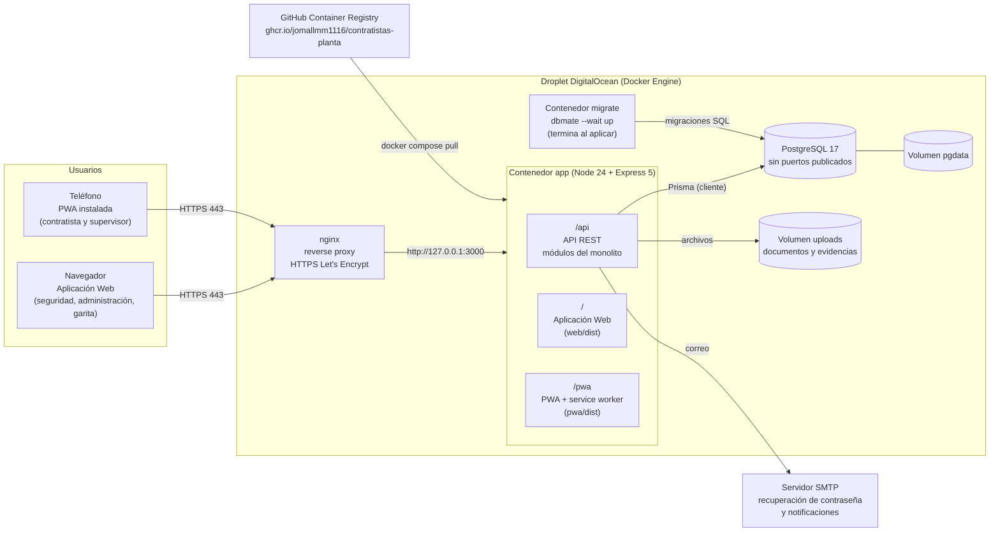
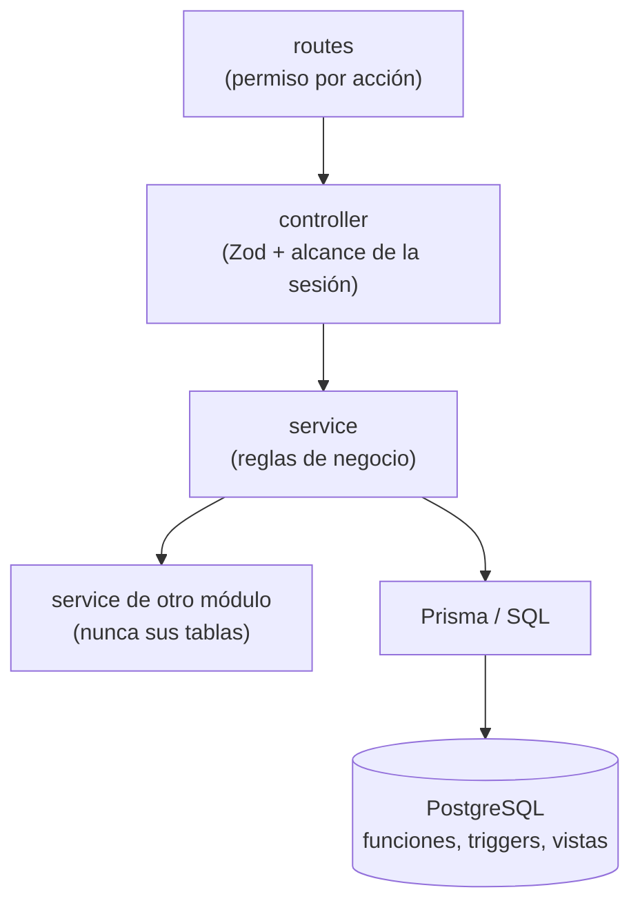

# Diagrama de arquitectura

Monolito modular: un solo contenedor Express sirve la API (`/api`), la Aplicación Web (`/`) y la PWA
(`/pwa`), detrás de nginx con HTTPS, y usa PostgreSQL en la red interna de Docker.

## Componentes

| Componente | Responsabilidad |
|---|---|
| nginx | Única entrada pública; redirige HTTP a HTTPS y reenvía todo a la aplicación en `127.0.0.1:3000` |
| Contenedor `app` | Monolito modular: API REST, Aplicación Web y PWA en el mismo dominio (sin CORS ni problemas de cookies) |
| Contenedor `migrate` | Aplica las migraciones pendientes antes de iniciar la aplicación y termina |
| PostgreSQL | Base de datos; solo accesible desde la red interna de Docker |
| Volúmenes | `pgdata` (datos) y `uploads` (documentos y evidencias) sobreviven a reinicios y despliegues |
| GHCR | Guarda las imágenes versionadas que publica el pipeline |

## Capas dentro del monolito

