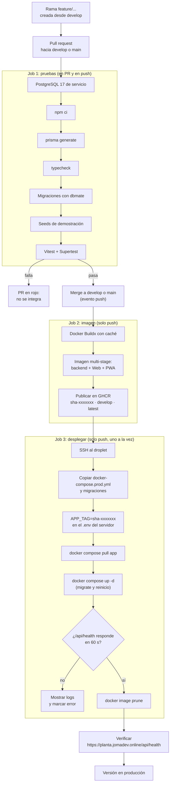

# Diagrama de CI/CD

Pipeline de GitHub Actions (`.github/workflows/ci-cd.yml`). Un cambio llega a producción solo por
pull request y con todas las pruebas en verde.

| Etiqueta de la imagen | Significado |
|---|---|
| `sha-xxxxxxx` | Versión exacta de cada commit (la que se despliega y queda en el `.env` del servidor) |
| `develop` | Última versión de la rama `develop` |
| `latest` | Última versión de la rama `main` |
