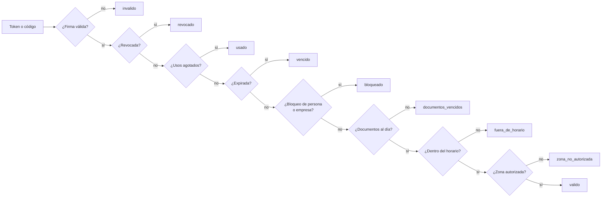

# Diagrama del flujo de acceso (solicitud → credencial → garita)

Flujo principal del sistema: desde la solicitud de acceso hasta el ingreso y la salida en garita.

```mermaid
sequenceDiagram
    autonumber
    actor RI as Responsable interno (Web)
    actor SI as Seguridad industrial (Web)
    actor CO as Contratista (PWA)
    actor GA as Garita (Web)
    participant API as API Express
    participant BD as PostgreSQL

    RI->>API: Crear solicitud (empresa, contratistas, zonas, fechas, horario)
    API->>BD: solicitudes_acceso en borrador
    RI->>API: Enviar solicitud
    API->>BD: Verifica contratistas activos y sin bloqueos; estado pendiente

    SI->>API: Evaluación de riesgo (si el tipo de trabajo la exige)
    SI->>API: Autorizar (una o dos etapas según el riesgo)
    API->>BD: fn_requisitos_incumplidos (documentos y capacitaciones al día)
    API->>BD: Estado aprobada + historial_estados (trigger)

    SI->>API: Emitir credencial (usos ilimitados o máximo)
    API->>BD: credenciales activa (una sola por persona y solicitud)
    API-->>SI: Token JWT firmado (audiencia credencial) + QR + código corto

    CO->>API: GET /credenciales/mias y /credenciales/:id/qr
    API-->>CO: QR a pantalla completa en el teléfono

    GA->>API: Validar QR o código corto en una zona
    API->>BD: Firma, revocada, usada, vencida, bloqueos, documentos, horario y zona
    API->>BD: validaciones_credencial
    alt Resultado valido
        API-->>GA: ACCESO PERMITIDO
        GA->>API: Registrar entrada
        API->>BD: UPDATE atómico de usos + registros_acceso (entrada)
        Note over API,BD: Dos guardias a la vez no pueden usar el mismo último uso
    else invalido, revocado, usado, vencido, bloqueado, documentos_vencidos, fuera_de_horario o zona_no_autorizada
        API-->>GA: Acceso negado con el motivo
    end

    GA->>API: Registrar salida
    API->>BD: registros_acceso (salida), sin exigir credencial válida
```

## Orden de evaluación en garita



Un QR aislado no es una autorización: cada ingreso vuelve a consultar en el servidor todo lo anterior.
