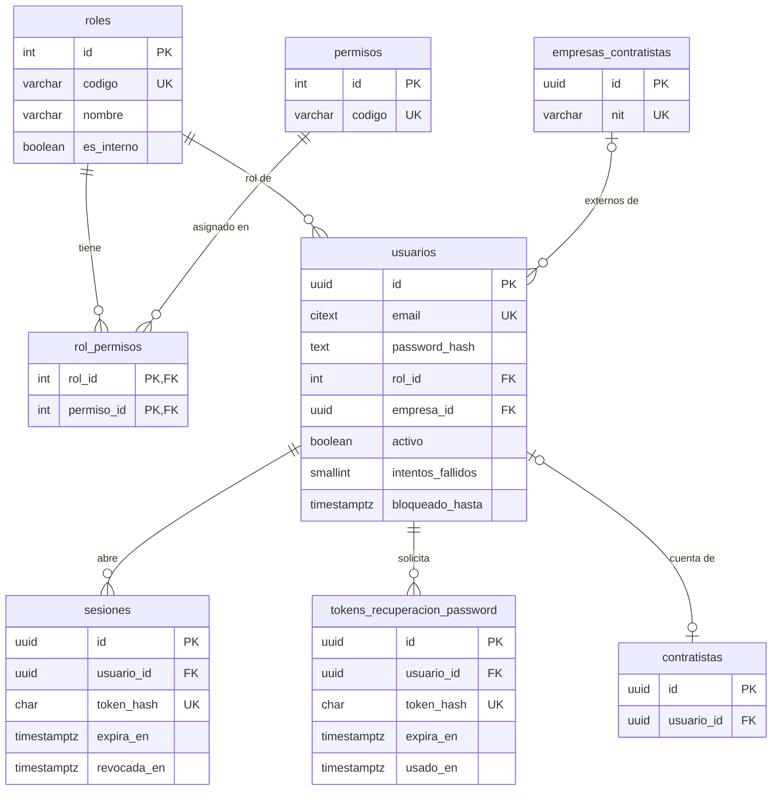
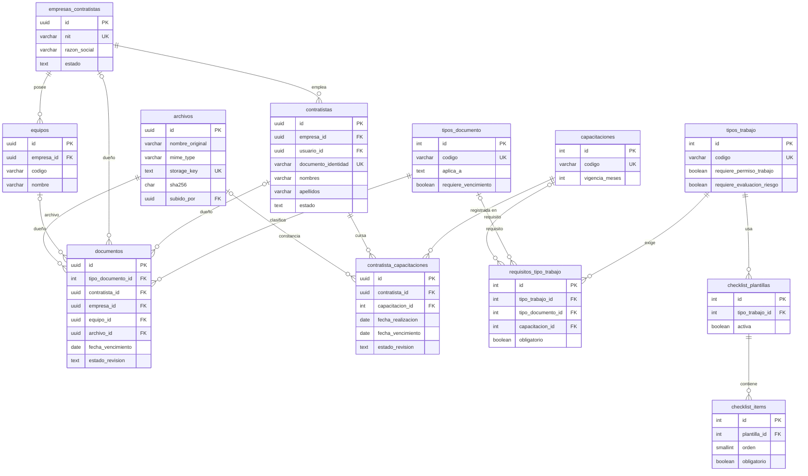
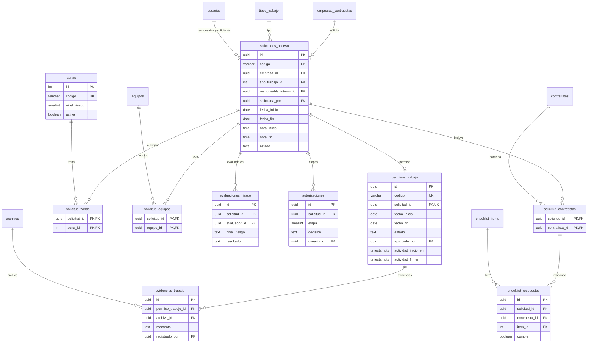
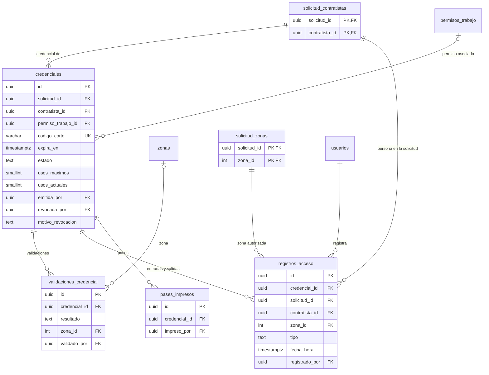
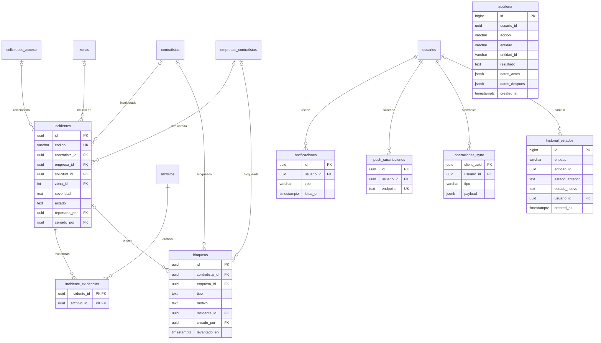

# Modelo de datos

Diagrama entidad-relación de PostgreSQL, obtenido del esquema real (`server/prisma/schema.prisma`,
generado por introspección de las migraciones de `db/migrations/`). Se divide por áreas para que sea
legible; las tablas que aparecen en más de un área son las mismas.

Convenciones: catálogos con clave `int` (identidad) y registros transaccionales con `uuid`; estados como
texto con `CHECK`; fechas `timestamptz` (o `date` / `time` donde corresponde).

## 1. Seguridad y usuarios

## 2. Empresas, personas y requisitos

Un documento tiene **exactamente un dueño** (contratista, empresa o equipo), regla `CHECK` de la base.

## 3. Solicitudes y permisos de trabajo

Una solicitud tiene **como máximo un** permiso de trabajo (`solicitud_id` único). Las autorizaciones son
únicas por solicitud y etapa.

## 4. Credenciales y garita

Claves foráneas **compuestas** que hacen cumplir reglas de negocio en la propia base:

| Relación | Regla que garantiza |
|---|---|
| `credenciales (solicitud_id, contratista_id)` → `solicitud_contratistas` | Solo se emite credencial a una persona incluida en la solicitud |
| `credenciales (permiso_trabajo_id, solicitud_id)` → `permisos_trabajo (id, solicitud_id)` | El permiso asociado es de la **misma** solicitud |
| `registros_acceso (solicitud_id, zona_id)` → `solicitud_zonas` | No se puede registrar un acceso a una zona no autorizada |
| `registros_acceso (credencial_id, solicitud_id)` → `credenciales (id, solicitud_id)` | La credencial corresponde a esa solicitud |
| Índice único parcial `ux_credencial_activa` | Una sola credencial **activa** por persona y solicitud |

## 5. Incidentes, bloqueos, avisos y trazabilidad

| Tabla | Nota |
|---|---|
| `bloqueos` | Exactamente un objetivo: contratista **o** empresa (`CHECK`). Es la única fuente de verdad de los bloqueos |
| `auditoria` | Solo inserción: triggers bloquean actualizar, borrar y truncar. Guarda el correo además del id para conservar la evidencia |
| `historial_estados` | Solo inserción; la escriben triggers al cambiar el estado de solicitudes, permisos, credenciales e incidentes |
| `push_suscripciones`, `operaciones_sync` | Previstas en el modelo para notificaciones push y cola offline; sin uso en esta versión |

## Funciones y vistas de la base

| Objeto | Uso |
|---|---|
| `fn_requisitos_incumplidos(solicitud, contratista)` | Documentos y capacitaciones obligatorios faltantes o vencidos |
| `fn_permiso_vigente(permiso)` | Si el permiso está dentro de su fecha y horario (hora de Guatemala) |
| `fn_contratista_bloqueado(contratista)` | Bloqueo propio o de su empresa |
| `v_personas_en_instalacion` | Personas cuyo último movimiento es una entrada |
| `v_documentos_por_vencer` | Documentos próximos a vencer (avisos y dashboard) |
